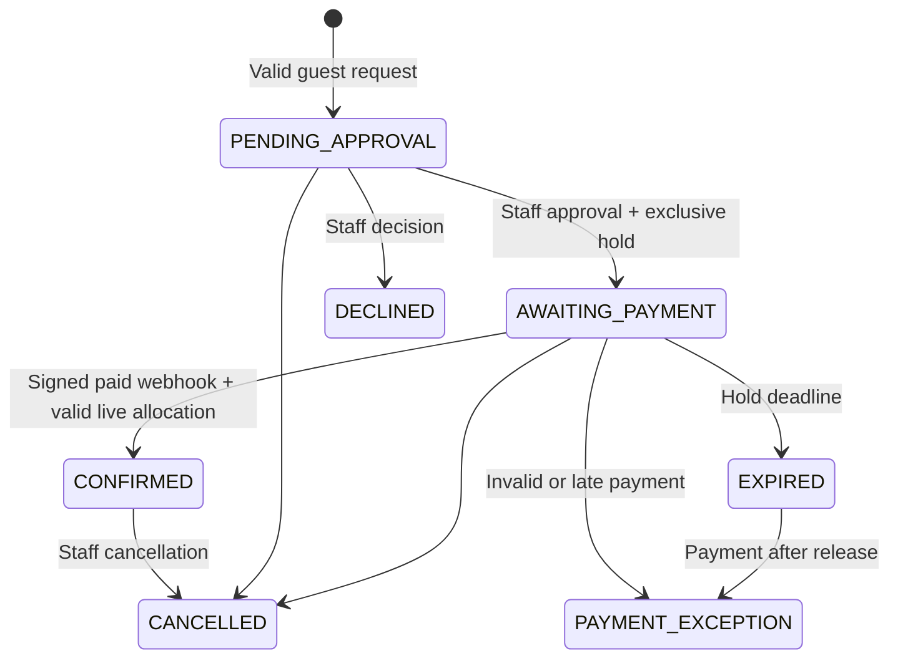

# Architecture and operational guarantees

## Authority boundaries

Sanity owns published editorial copy, venue details, menu items, gallery, event artwork/descriptions, page introductions, and policy/SEO copy. Supabase PostgreSQL owns event operational identifiers, booking windows, eligible sections, pricing overrides, inventory, requests, payments, roles, and audit history. The browser never queries customer tables. Server-only adapters hold service-role credentials.

Event import is an explicit authenticated action: read a published Sanity event → upsert by stable Sanity ID → return operational UUID → editor records UUID in Sanity. It does not overwrite booking windows or active allocations. Schedule changes are rejected when requests/bookings exist; cancellations are separate operational actions. CMS content can promote a night but cannot create inventory.

## Reservation lifecycle

Requests do not reserve inventory. Approval validates current schedule, event eligibility, capacity, blackout intervals, arrival, prices, and saved policy. Changed terms require a new guest-reviewed request. Holds expire at the earlier of 24 hours and the booking deadline, with at least 31 minutes needed for Stripe Checkout.

## Database safety

`inventory_holds` is the shared active-allocation relation for approved holds, confirmed bookings, and manual bookings. A partial GiST exclusion constraint prevents overlap for the same section and half-open booking interval. Confirmed allocations have no expiration; cancelled/expired allocations become inactive. `confirmed_reservations` records the successful allocation/payment reconciliation.

Mutating inventory functions share a transaction-scoped advisory lock. This deliberately serializes a single venue’s low-volume inventory changes and avoids lock-order races across cancellation, expiry, payments, rescheduling, blackout creation, and approvals. Row locks and the exclusion constraint remain database invariants. A multi-venue/high-throughput version should partition locking after measured load tests. Expiry-sensitive comparisons use `clock_timestamp()` so time spent waiting for a lock does not extend payment eligibility.

Request UUIDs deduplicate network retries. Stripe event IDs and Checkout session/payment-intent IDs deduplicate payment delivery. A successful redirect is informational only. Checkout price, currency, and reservation ID come from the server, and settlement rechecks amount, currency, saved session, reservation status, live hold, and deadline. Late payments never take someone else’s allocation. They create an exception for refund or management resolution. An additional payment never invalidates an already-confirmed reservation.

Rescheduling temporarily releases the original allocation within the transaction, validates the new one, and updates it atomically. Failure rolls everything back. Capacity triggers prevent shrinking below active booking party sizes. Blackouts cannot silently invalidate a live allocation. Manual requests use the same functions as online bookings.

## Security

- Supabase Auth cookies are refreshed in `proxy.ts`; server actions and protected page handlers verify the user via `getUser()` and check a server-side role.
- Operational tables enable RLS and revoke anon/authenticated access. Staff can read only their own role through the authenticated database role. Service-only functions explicitly revoke default PUBLIC execution.
- Functions that act as staff validate the actor’s role again in PostgreSQL. Editors have no customer/payment access. Only owners manage roles; they cannot change their own role.
- Customer links contain 256 random bits, are stored as SHA-256 hashes, and expire after 30 days. Renewal requires the original email/reference and returns an enumeration-resistant response. Customer pages are dynamic, private, no-store, no-referrer, and noindex.
- JSON writes require a matching Origin, bounded body size, schema validation, durable rate limiting, and production Turnstile verification. Vercel forwarding headers must be trusted only behind the configured platform proxy.
- Stripe verifies raw-body signatures. Card details remain in Stripe Checkout. No payment credentials reach the client.
- Private section uploads are size/type checked and stored in a non-public Supabase bucket. Published eligible section views receive expiring signed image URLs.
- Audit records cover staff changes. Sensitive operations use transactional audit writes. Uploads can leave an unreferenced file if a later save fails; review orphan media periodically.

## Notifications and refunds

Reservation/inquiry writes enqueue email transactionally. The cron worker leases up to 20 outbox rows with `SKIP LOCKED`, sends Resend messages using notification-ID idempotency keys, and marks successful delivery. Failures back off and are visible in staff payments/notification monitoring; after 12 attempts, staff intervention is required. The job also expires holds, removes expired access/rate-limit records, and reconciles pending refunds.

Full refunds require manager/owner review. A confirmed booking must be cancelled first. Stripe refund requests use a stable payment idempotency key, and webhook/cron updates reconcile provider status. No cancellation promises an automatic refund.

## Documentation sources

[Supabase Next.js SSR guidance](https://supabase.com/docs/guides/auth/server-side/creating-a-client?queryGroups=framework&framework=nextjs), [Sanity Next.js integration](https://www.sanity.io/docs/nextjs), [Stripe Checkout fulfillment](https://docs.stripe.com/checkout/fulfillment), [PGlite extensions](https://pglite.dev/extensions/).
